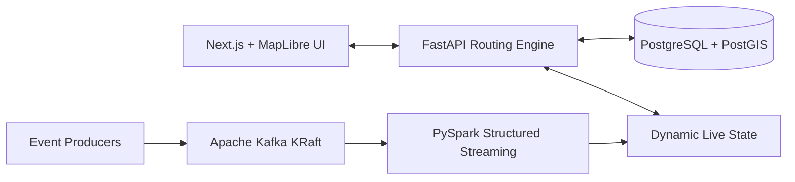

# CityFlow 🚇🚌🚶

> **Multimodal Urban Journey Planner & Mobility Intelligence Platform for Bengaluru**

[](https://github.com/kaushikbalaji/cityflow/actions)
[](LICENSE)
[](https://python.org)
[](https://nextjs.org)
[](https://fastapi.tiangolo.com)
[](https://postgis.net)
[](https://kafka.apache.org)
[](https://spark.apache.org)

---

## 🌟 Overview

**CityFlow** is an end-to-end urban transit intelligence and journey-planning engine initially focused on Bengaluru, India. It models real-world urban transit conditions across multiple transport modes:
- 🚶 **Walking** (Pedestrian footpaths, station access, transfer walks)
- 🚌 **BMTC Buses** (Bangalore Metropolitan Transport Corporation scheduled routes, Ordinary & Vajra AC)
- 🚇 **Namma Metro** (BMRCL Purple, Green, and connecting corridors)
- 🚗 **Road Vehicles** (Congestion-aware driving & auto-rickshaw routing)

### Key Features
- **Multi-Objective Optimization:** Compare journeys by fastest arrival, lowest cost (₹ INR), fewest transfers, or least walking.
- **Realistic Transfer Logic:** Station ingress/egress penalties, waiting-time estimations, and platform interchange delays.
- **Dynamic Streaming Intelligence:** Real-time road congestion and transit delay events ingested through **Apache Kafka** and aggregated using **PySpark Structured Streaming**.
- **Transparent Assumptions:** Clear labeling of scheduled timetables, walking speeds (1.2 m/s), and simulated delay factors.

---

## 🏗️ Architecture



For the full architectural breakdown, data-source feasibility matrix, and routing algorithm specifications, refer to [docs/architecture/STAGE_0_RESEARCH_AND_ARCHITECTURE.md](docs/architecture/STAGE_0_RESEARCH_AND_ARCHITECTURE.md).

---

## 🚀 Quick Start (Local Development)

### Prerequisites
- **Node.js**: v20+ (v24 recommended)
- **Python**: 3.11+ (3.13 recommended)
- **Docker & Docker Compose** (Optional for containerized mode)

### 1. Clone & Configure
```bash
git clone https://github.com/kaushikbalaji/cityflow.git
cd cityflow
cp .env.example .env
```

### 2. Run Backend (FastAPI)
```bash
cd backend
python -m venv venv
# Windows:
.\venv\Scripts\activate
# Linux/macOS:
source venv/bin/activate

pip install -r requirements.txt
uvicorn app.main:app --reload --port 8000
```
API Documentation will be accessible at: `http://localhost:8000/docs`

### 3. Run Frontend (Next.js)
```bash
cd frontend
npm install
npm run dev
```
Open `http://localhost:3000` in your browser.

---

## 🧪 Testing

```bash
# Run backend & routing engine test suite
cd backend
pytest -v

# Run frontend tests
cd frontend
npm test
```

---

## 📄 License
This project is open-source and available under the [MIT License](LICENSE).
