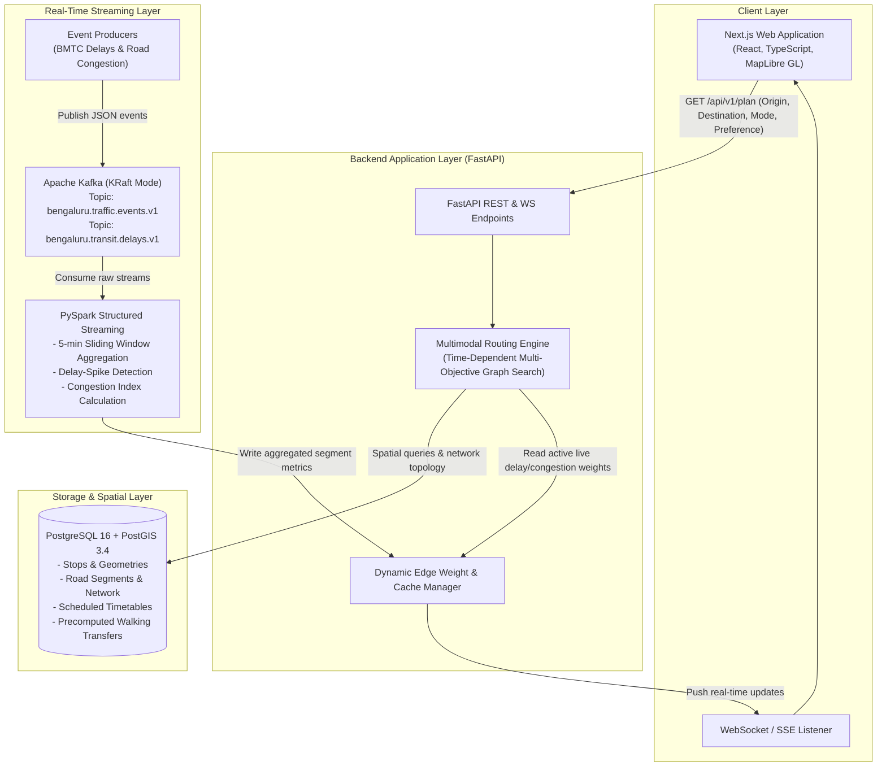

# CityFlow — Stage 0: Research & Architecture Specification

## 1. Executive Summary & Vision
CityFlow is a production-minded multimodal urban journey planner and mobility intelligence platform designed for Bengaluru, India. It models real-world urban transit complexities:
- Multimodal journey options: Walking, BMTC (Bangalore Metropolitan Transport Corporation) buses, Namma Metro (BMRCL), and private vehicle / auto-rickshaw road-routing.
- Multi-criteria optimization: Fastest arrival, lowest estimated cost (INR), least walking distance, fewest transfers, and balanced journey score.
- Dynamic intelligence: Real-time traffic congestion spikes and transit delay events ingested via Apache Kafka and aggregated using PySpark Structured Streaming to update routing travel-time estimates dynamically.

---

## 2. Architecture Diagram



---

## 3. Data-Source Feasibility Matrix

| Data Source | Entity | Data Provided | Temporal Nature | Access Method | Licensing & Attribution | Rate Limits & Auth | Known Reliability & Limitations | Feasibility in CityFlow |
| :--- | :--- | :--- | :--- | :--- | :--- | :--- | :--- | :--- |
| **BMTC Open Transit Data** | Bangalore Metropolitan Transport Corporation / OpenCity.in / WRI India | Bus stops (6,000+), route itineraries (V-Series, G-Series, MF feeder routes), schedules, frequencies. | Scheduled & Static GTFS | Public download (GTFS zip, GeoJSON, CSV) via OpenCity.in portal | Open Data Commons / CC-BY 4.0; BMTC attribution required | None for static files; public archive | No official public SLA; schedules often reflect ideal timetables rather than real-world traffic delays. | **Primary static transit source** for BMTC bus legs and stop coordinates. |
| **BMTC ITS / Namma BMTC Backend** | BMTC Intelligent Transport System | Live GPS vehicle positions, ETA at bus stops. | Live (10-30s polling) | Proprietary mobile app API (TLS-encrypted endpoints) | Proprietary; no open developer license or official API portal | Restricted / token-authenticated with device signature | High risk of endpoint deprecation, IP blocking, reverse-engineering legal hurdles. | **Not viable for public portfolio without NDA/contract.** Simulated live delay events modeled after real corridor stats. |
| **Namma Metro (BMRCL)** | Bangalore Metro Rail Corporation Limited | Station locations, Purple, Green, Yellow line alignments, timetables, interchange points (Majestic, etc.). | Scheduled (Fixed 5-15 min headways) | Official portal (bmrc.co.in) schedule tables, OpenCity GeoJSON | Public transit info; CC-BY compatible attribution | None for static timetables | Does not provide a public GTFS-RT feed for real-time train positions. | **Primary static metro source**. Highly accurate station geometries & fixed headway timetables. |
| **OpenStreetMap (OSM)** | OpenStreetMap Contributors (Geofabrik Karnataka extract) | High-fidelity road network, pedestrian footways, pedestrian crossings, signals, turn restrictions. | Static / Community live edits | Overpass API or Geofabrik `.osm.pbf` extract | Open Database License (ODbL) 1.0; "© OpenStreetMap contributors" | Overpass API rate limits (1 request/sec); local `.osm.pbf` processing has zero rate limits | Footway connectivity in some suburban areas has minor gaps, requiring Euclidean fallback for micro-walking links. | **Primary road & walking network source**. Processed into road segments and walk transfer edges. |
| **Bengaluru Traffic Police (ASTrAM / B-TRAC)** | Bengaluru Traffic Police | Major corridor congestion warnings, junction queue lengths. | Semi-live / Advisory notices | Web advisories, Twitter/X alerts, ASTrAM internal portal | Government public advisories; non-commercial reproduction | No public structured JSON REST API available to developers | Mostly qualitative text alerts ("Heavy waterlogging at Silk Board junction") rather than numerical edge speeds. | **Informs congestion generator parameters** for key corridors (Silk Board, Outer Ring Road, Tin Factory, Hebbal). |
| **Commercial APIs (TomTom / HERE / Google)** | Commercial Vendors | Live speeds, travel times, incident events across road segments. | Live (1-2 min freshness) | REST APIs with API key | Commercial proprietary; requires credit card & billing; prohibits caching beyond cache-control | Free tiers: 2,500 req/day (TomTom), 25,000 tx/mo (HERE). Hard limits. | Risk of credential leakage in public portfolio; cost unpredictability; external API downtime breaks local runs. | **Optional secondary adapter**. System must default to self-contained simulated traffic streams. |

---

## 4. Transport Graph and Database Design

### 4.1 Spatial Database Schema (PostgreSQL + PostGIS)

```sql
-- Core transit stops (Bus stops, Metro stations)
CREATE TABLE transit_stops (
    id VARCHAR(64) PRIMARY KEY,
    name VARCHAR(255) NOT NULL,
    mode VARCHAR(32) NOT NULL, -- 'bus', 'metro'
    line_name VARCHAR(128),    -- e.g. 'Purple Line', 'Route 500-D'
    platform_code VARCHAR(32),
    location GEOMETRY(Point, 4326) NOT NULL,
    is_wheelchair_accessible BOOLEAN DEFAULT FALSE,
    created_at TIMESTAMP WITH TIME ZONE DEFAULT CURRENT_TIMESTAMP
);
CREATE INDEX idx_transit_stops_geom ON transit_stops USING GIST(location);

-- Route definitions
CREATE TABLE transit_routes (
    id VARCHAR(64) PRIMARY KEY,
    short_name VARCHAR(64) NOT NULL,
    long_name VARCHAR(255) NOT NULL,
    mode VARCHAR(32) NOT NULL,
    agency VARCHAR(64) NOT NULL, -- 'BMTC', 'BMRCL'
    fare_tier VARCHAR(32) NOT NULL -- 'ordinary', 'vajra_ac', 'metro_standard'
);

-- Transit directed legs (Scheduled or Headway-based)
CREATE TABLE transit_segments (
    id VARCHAR(64) PRIMARY KEY,
    route_id VARCHAR(64) REFERENCES transit_routes(id),
    from_stop_id VARCHAR(64) REFERENCES transit_stops(id),
    to_stop_id VARCHAR(64) REFERENCES transit_stops(id),
    scheduled_travel_time_sec INTEGER NOT NULL,
    distance_meters DOUBLE PRECISION NOT NULL,
    headway_seconds INTEGER NOT NULL, -- typical interval between departures (e.g. 300s = 5m)
    departure_offset_seconds INTEGER NOT NULL,
    base_fare DOUBLE PRECISION NOT NULL,
    geometry GEOMETRY(LineString, 4326) NOT NULL
);
CREATE INDEX idx_transit_segments_stops ON transit_segments(from_stop_id, to_stop_id);

-- Road network nodes and segments (for walking & road driving)
CREATE TABLE road_segments (
    id VARCHAR(64) PRIMARY KEY,
    source_node_id VARCHAR(64) NOT NULL,
    target_node_id VARCHAR(64) NOT NULL,
    road_name VARCHAR(255),
    road_type VARCHAR(64) NOT NULL, -- 'primary', 'secondary', 'residential', 'footway'
    length_meters DOUBLE PRECISION NOT NULL,
    free_flow_speed_kmh DOUBLE PRECISION NOT NULL,
    base_traversal_time_sec INTEGER NOT NULL,
    geometry GEOMETRY(LineString, 4326) NOT NULL
);
CREATE INDEX idx_road_segments_geom ON road_segments USING GIST(geometry);

-- Transfer edges (Precomputed walking connections between nearby stops)
CREATE TABLE transfer_edges (
    id VARCHAR(64) PRIMARY KEY,
    from_stop_id VARCHAR(64) REFERENCES transit_stops(id),
    to_stop_id VARCHAR(64) REFERENCES transit_stops(id),
    walking_distance_meters DOUBLE PRECISION NOT NULL,
    walking_duration_sec INTEGER NOT NULL,
    is_same_station BOOLEAN DEFAULT FALSE
);
CREATE INDEX idx_transfers_from_stop ON transfer_edges(from_stop_id);
```

---

## 5. Routing Algorithm Design

CityFlow implements a **Time-Dependent Multimodal Multi-Objective Graph Search**:
- **Algorithm Foundation:** Modified Priority-Queue Dijkstra with Pareto-dominance pruning and heuristic guidance (Multimodal A* / RAPTOR-style round decomposition).
- **State Representation:** State at stop $u$ is represented by a tuple:
  $$S(u) = (T_{\text{arr}}, \text{Cost}, N_{\text{transfers}}, D_{\text{walk}})$$
- **Pareto Dominance:** A candidate state $S_1$ dominates $S_2$ if it is strictly better in at least one objective and no worse in all others. Non-dominated states are preserved in the label set of node $u$.
- **Edge Types & Time Costs:**
  1. **Walk Edge:** $T_{\text{walk}} = \frac{D_{\text{walk}}}{v_{\text{walk}}}$, where $v_{\text{walk}} \approx 1.2\text{ m/s}$ (4.32 km/h).
  2. **Scheduled Transit Edge (Bus/Metro):**
     Arrival time at downstream stop:
     $$T_{\text{arr}} = T_{\text{curr}} + T_{\text{wait}}(\text{route}, T_{\text{curr}}) + T_{\text{travel\_scheduled}} + \Delta_{\text{delay}}$$
     where waiting time $T_{\text{wait}}$ is computed from the next departure in the timetable or headway $H$:
     $$T_{\text{wait}} = (H - (T_{\text{curr}} \pmod H)) \pmod H$$
  3. **Transfer Penalty:** An ergonomic penalty $\tau_{\text{transfer}} = 120\text{ seconds}$ (station ingress/egress, ticketing, platform change) is added whenever switching transit modes.
  4. **Dynamic Road Congestion Edge:**
     $$T_{\text{road}} = T_{\text{base}} \times (1 + \alpha_{\text{congestion}})$$
     where $\alpha_{\text{congestion}}$ is streamed from PySpark analytics.
- **Optimization Objectives Supported:**
  - `fastest`: Minimizes total elapsed time $T_{\text{arr}} - T_{\text{dep}}$.
  - `lowest_cost`: Minimizes financial fare in INR (Metro smart card / BMTC ordinary vs Vajra).
  - `least_walking`: Minimizes total pedestrian distance $D_{\text{walk}}$.
  - `fewest_transfers`: Minimizes transfer count $N_{\text{transfers}}$.
  - `balanced`: Weighted composite cost function:
    $$J = (T_{\text{travel\_min}} \times 1.0) + (C_{\text{INR}} \times 0.5) + (N_{\text{transfers}} \times 10.0) + (D_{\text{walk\_km}} \times 15.0)$$

---

## 6. Kafka & Spark Streaming Data-Flow Design

### 6.1 Topics (KRaft Mode Single Broker)
1. `bengaluru.traffic.events.v1`
   - Key: `road_segment_id` (string)
   - Partitions: 3
   - Value Schema: JSON event containing `event_id`, `segment_id`, `corridor_name`, `speed_kmh`, `congestion_level` (LOW, MEDIUM, HIGH, SEVERE), `observed_at`, `source`.
2. `bengaluru.transit.delays.v1`
   - Key: `route_id` (string)
   - Partitions: 3
   - Value Schema: JSON event containing `event_id`, `route_id`, `stop_id`, `delay_seconds`, `cause` (TRAFFIC_HOLD, MECHANICAL, WEATHER), `observed_at`.

### 6.2 PySpark Structured Streaming Pipeline
- **Windowing:** 5-minute sliding event-time window with 1-minute slide and 2-minute watermark for handling late-arriving events.
- **Analytics Computed:**
  1. Exponentially Weighted Moving Average (EWMA) speed and travel-time multiplier per road segment.
  2. Transit Delay Spike Detection (flagging segments where delay exceeds $\mu + 2\sigma$ of normal headway).
  3. Real-Time Corridor Health Index (0-100 scale).
- **Downstream Output:** Atomically writes segment metric snapshots to shared state cache / database table and publishes alerts.

---

## 7. API Contract Outline

- `GET /api/v1/health`
  - Returns service status, database connectivity, Kafka readiness, and active route graph size.
- `GET /api/v1/stops`
  - Parameters: `bbox`, `mode`, `limit`
  - Returns GeoJSON FeatureCollection of transit stops.
- `GET /api/v1/plan`
  - Parameters:
    - `origin_lat`, `origin_lon` (float, required)
    - `dest_lat`, `dest_lon` (float, required)
    - `modes` (list of strings, default: `["walk", "bus", "metro"]`)
    - `objective` (enum: `fastest`, `lowest_cost`, `least_walking`, `fewest_transfers`, `balanced`)
    - `departure_time` (ISO 8601 string, optional, default: now)
  - Returns: Array of candidate `Journey` objects with detailed `legs`, geometry (GeoJSON LineString), durations, waiting times, transfer walks, fare estimates, and assumption breakdown (e.g. static scheduled vs live adjusted).
- `GET /api/v1/live/corridors`
  - Returns current congestion multipliers and transit delays for key Bengaluru corridors.
- `WebSocket /api/v1/live/ws`
  - Streaming push of delay updates and recalculated trip ETAs for active sessions.

---

## 8. Windows Development & Docker Plan
- **Resource Constraints:** Designed to operate comfortably within a 16 GB RAM Windows 11 host.
- **Single Broker Kafka:** Apache Kafka in KRaft mode (no Zookeeper required, minimizing JVM memory overhead to ~512 MB heap).
- **Spark:** PySpark runs in local mode (`master="local[2]"`) with max 1 GB driver memory.
- **PostgreSQL / PostGIS:** Postgres 16 Alpine container with PostGIS, allocating ~512 MB shared buffers.
- **Dual Runtime Support:**
  - Containerized: `docker compose up` starts Postgres, Kafka, Spark, Backend, Frontend.
  - Native Windows Fallback: Backend runs directly via `python -m uvicorn`, Frontend runs via Node 24 `npm run dev`, using SQLite/SpatiaLite or standard PostgreSQL if Docker is inactive or during rapid iteration.

---

## 9. Test & Benchmarking Strategy
- **Unit Tests:**
  - Graph topology validity (no orphan stops, bidirectional road segments where applicable).
  - Fare calculation logic against BMTC stage charts and BMRCL fare slabs.
  - Geometry distance and Haversine calculations.
- **Deterministic Routing Algorithm Tests:**
  - Hand-calculated miniature transit network with known optimal paths:
    1. Origin equals destination (zero distance, zero time).
    2. Unreachable destination (graceful empty result with explanation).
    3. Direct walk vs faster transit requiring a transfer.
    4. Headway waiting time calculations.
    5. Congestion spike rerouting (verifying that severe congestion on Route A redirects candidate journey to Metro Route B).
- **Streaming Pipeline Tests:**
  - Replayable JSON fixture streams to verify PySpark window aggregation, watermark handling, and idempotent state updates.

---

## 10. Stage-by-Stage Implementation Plan
- **Stage 0:** Research & Architecture (This document, repository scaffold, git init, baseline verification).
- **Stage 1:** Route-Planning MVP (Working interactive MapLibre frontend + local Bengaluru transport graph + multi-modal candidate journeys).
- **Stage 2:** FastAPI Backend & Spatial PostGIS Database (Schemas, endpoints, migrations, seed datasets).
- **Stage 3:** Multimodal Routing Engine (Formal Pareto-Dijkstra / A* engine with transfer penalties, multi-objective metrics, exhaustive unit tests).
- **Stage 4:** Kafka Event Ingestion (KRaft single broker, event schemas, synthetic producers for Bengaluru corridors).
- **Stage 5:** PySpark Structured Streaming (Sliding window aggregations, delay spike detection, checkpointing).
- **Stage 6:** Dynamic Routing & Live Updates (Feed streaming weights into routing engine, live updates, UI route comparison before/after delay).
- **Stage 7:** Predictive Analytics (Baseline vs short-term congestion forecast models, time-aware validation).
- **Stage 8:** Testing, Security & Optimization (Performance profiling, latency measurement, regression tests).
- **Stage 9:** Portfolio-Ready Release (Documentation, screenshots, setup scripts, GitHub release).

---

## 11. Risks, Assumptions & Unresolved Decisions
1. **Live GPS Data Availability:** BMTC does not provide a publicly licensed, authenticated developer REST/GTFS-RT feed. *Mitigation:* Explicitly label scheduled transit as scheduled, and model dynamic delays via realistic, calibrated corridor event streams that can consume real feeds when an enterprise API key is provided.
2. **Memory Footprint:** Running Kafka, Spark, PostGIS, FastAPI, and Next.js simultaneously on 16 GB Windows requires disciplined JVM heap limits.
3. **Docker CLI PATH Availability:** The `docker` and `gh` binaries are not currently present in the user's default system PATH in the current PowerShell environment. The architecture is built modularly so that Stage 1 and Stage 2 can run natively via Node.js and Python while providing standard Docker configurations.
